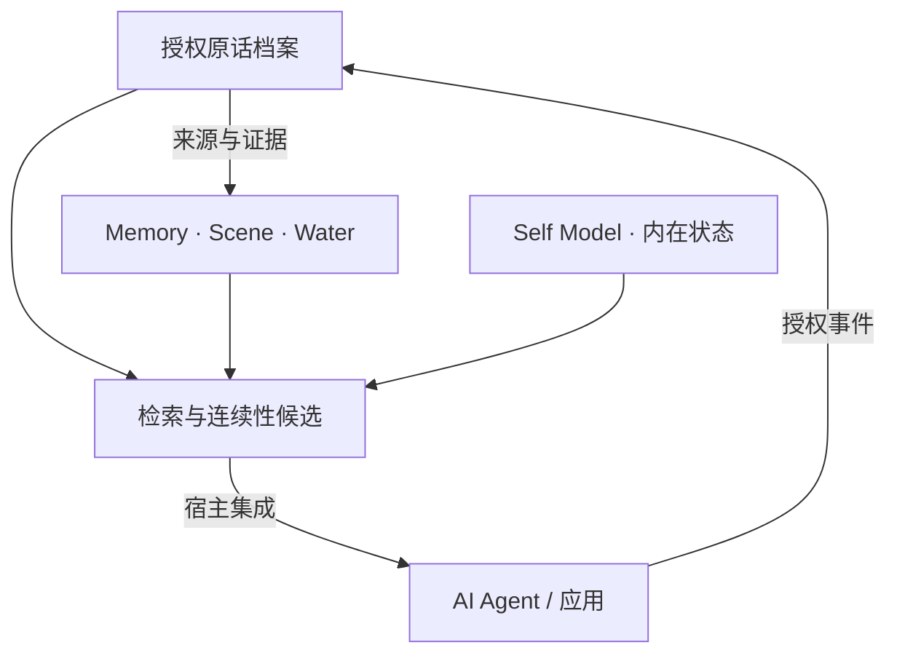

<div align="center">


**洄海 · 让 AI 记得发生过什么，也理解经历如何延续。**

源自念念长期运行实践的 **AI 记忆与连续性系统**。<br>
连接原话证据、可修订的长期记忆与身份状态，让每一次回忆有出处。

[](https://github.com/yuyu1838309000-cmd/Thalemora/tree/v0.4.0)
[](pyproject.toml)
[](LICENSE)

[核心能力](#核心能力) · [快速开始](#快速开始) · [接入与文档](#接入与文档) · [来源与致谢](#来源与致谢)

</div>

## 核心能力

洄海把记忆分成三个相互连接的部分：**发生过什么、值得长期记住什么、这些经历如何延续**。

| 能力 | 作用 |
| :--- | :--- |
| **原话与证据** | 按授权保存历史原话和来源，记录时间、编辑与删除状态；记忆可以回查证据。 |
| **可修订记忆** | 管理补充、更正与替代，保留修订链和字段来源，保护人工维护的内容。 |
| **水系与经历** | 通过湖、溪流、支流组织故事线；Scene 核心按经历片段组织记忆候选。 |
| **身份与内在世界** | 管理 Self Model、Persona、情绪、日记、梦境、低语和反思；本人创作与自我修订需要可信 Agent 事件。 |
| **多 Agent 与跨应用** | 隔离身份、数据与检索；同一 Agent 的应用来源经过授权后可以共享档案。 |
| **本地优先** | 无模型 Key 可导入、浏览、原话检索和人工管理记忆；云端模型按用途配置，付费调用默认关闭。 |

### 0.4.0 可以做什么

- **独立运行**：中文 Web 管理台、Python、HTTP、MCP，以及 Docker Compose。
- **管理与检索**：历史导入、原话搜索、人工 Memory / Water 操作、内在状态浏览和人格配置。
- **保存与恢复**：全量历史导入导出、停止写入后的实例快照与恢复、Provider 配置及调用用量审计。
- **宿主集成**：Scene、Gatekeeper、生命周期及 Self Model 等领域核心可由 Python 接入。

自动 Writer / Gatekeeper / Reflection 模型管线、真实 Agent 的证据接线与念念生产迁移仍待完成。当前 Provider 接口用于显式调用；本地向量检索需由 Python 宿主提供 embedder。具体可用入口见 [使用手册](docs/P4_USAGE.md)。

### 数据如何连接



图中表示领域之间的数据关系。洄海提供记忆和连续性材料，宿主应用负责聊天、上下文组装与工具执行。

## 快速开始

需要 **Python 3.10+**。首次启动无需模型 Key。

```bash
git clone https://github.com/yuyu1838309000-cmd/Thalemora.git
cd Thalemora

python3 -m venv .venv
. .venv/bin/activate
python -m pip install -c requirements.lock .

export THALEMORA_TOKEN="$(python -c 'import secrets; print(secrets.token_urlsafe(32))')"
printf '%s\n' "$THALEMORA_TOKEN"
thalemora --data ./state serve
```

打开 **http://127.0.0.1:8765**，填入终端输出的管理 token，然后：

1. 注册一个 Agent。
2. 授权来源 `demo-app` 和通道 `main`。
3. 导入 [合成历史示例](docs/examples/p4_history.json)，开始浏览、检索与整理记忆。

管理 token 具有实例所有者权限；私人通道需要单独授权。模型不会在启动时自动下载或调用。

<details>
<summary><strong>使用 Docker Compose</strong></summary>

克隆仓库并设置上面的 `THALEMORA_TOKEN` 后，执行：

```bash
docker compose -f deploy/compose.yaml up --build -d
```

默认地址仍为 `http://127.0.0.1:8765`，数据保存在独立命名卷中。容器模型配置、日志及停止写入后的备份恢复见 [使用手册](docs/P4_USAGE.md)。

</details>

## 接入与文档

| 入口 | 适合的用途 | 文档 |
| :--- | :--- | :--- |
| **Web 管理台** | 导入历史、检索原话、整理记忆与查看状态 | [使用手册](docs/P4_USAGE.md) |
| **Python** | 领域核心、宿主证据与自我模型接线 | [应用 API](src/thalemora/app/service.py) · [合成宿主示例](tests/test_p3_inner_world.py) |
| **HTTP** | 通过 token 认证访问本地管理 API | [接口与参数](docs/P4_USAGE.md#python--http--mcp) |
| **MCP** | 本地 stdio 的 Agent 列表、搜索、历史和内在状态读取 | [MCP 配置](docs/P4_USAGE.md#python--http--mcp) |
| **导出与恢复** | 搬运授权历史、停止写入后制作和还原完整快照 | [恢复说明](docs/P4_USAGE.md#全量历史导出与恢复) |

## 来源与致谢

记忆设计重点参考了 [Yinglianchun/Ombre-Brain](https://github.com/Yinglianchun/Ombre-Brain) 的二次开发与上游 [Ombre Brain](https://github.com/P0luz/Ombre-Brain)。生命周期评分中的三天分段时间与情绪加权规则继承自这些实现；原作者版权和 MIT 许可已保留在 [第三方声明](THIRD_PARTY_NOTICES.md)。

也感谢 [Serein](https://github.com/Yinglianchun/Serein)、[Haven-Ombre](https://github.com/Yinglianchun/Haven-Ombre)、[Paramecium](https://github.com/Shitsuten/paramecium) 与 [awesome-ai-companion](https://github.com/DasterProkio/awesome-ai-companion) 提供的研究与开源参考。

| 协作 | 贡献 |
| :--- | :--- |
| **小鱼** | 项目发起与维护，产品方向、需求定义和最终验收。 |
| **ChatGPT（老大）** | AI 协作助手，参与方案审查、文档整理、开发与验证。 |

---

<div align="center">

[Apache License 2.0](LICENSE) · [第三方许可与来源](THIRD_PARTY_NOTICES.md)

</div>
