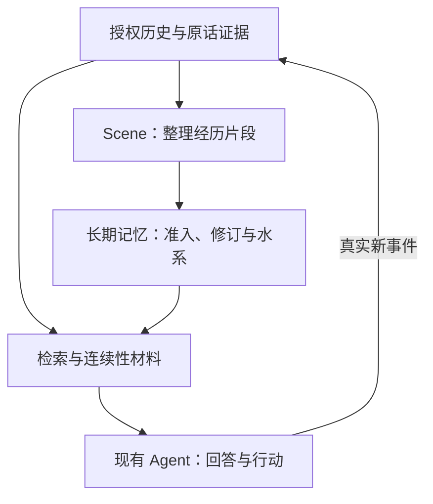

# Thalemora · 洄海

**让 AI 记得发生过什么，也理解经历如何延续。**

面向 AI Agent 的记忆与连续性系统，源自念念的长期运行实践。把原始对话、长期记忆与自我认识连起来，让记忆有出处、变化有依据、跨应用有延续。

> **首版功能范围（0.4.0）**：Python/HTTP/MCP、中文 Web、无 Key 原文检索与停写恢复已完成隔离验收；Docker 空实例健康、认证、导入、检索、人工记忆操作和许可文件均有实测。真实 Agent 接线、自动模型提炼和念念生产迁移不属于已完成的首版能力；下列产品范围包含后续目标。

## 洄海关注什么

洄海把“记住”分成三件事：**保留原话、维护长期记忆、延续身份与经历**。检索是其中一环，找到一段文字之后，还要知道它是否有效、为何变化、属于谁。

| 设计重点 | 带来的价值 |
| --- | --- |
| **原话可追溯** | 保存完整授权历史；记忆能回到原始证据，保留来源、时间与编辑删除状态。 |
| **记忆可修订** | 区分新经历、补充、更正与替代；保留版本链，保护人工维护的内容。 |
| **水系组织** | 用海、湖、溪流和支流整理持续故事线；归属不复制记忆正文，也不代替记忆本身。 |
| **身份与内在世界** | 连接自我模型、情绪、日记、梦境与反思；自我修订来自真实 Agent，梦境与现实分开记录。 |
| **跨应用延续** | 同一 Agent 经授权共享长期记忆；不同 Agent 的数据、检索与后台任务默认隔离。 |
| **本地优先** | 目标是无 API Key 也能导入、浏览与基础检索；云端模型可选，付费调用默认关闭。 |

## 记忆怎样延续



这是目标流程。洄海提供记忆和连续性材料，应用自己的 Runtime 负责聊天、上下文和工具执行。

## 产品范围

- **历史与记忆**：完整历史档案、原话证据、经历分段、长期记忆、水系组织、检索与生命周期。
- **身份与内在世界**：自我模型（Self Model）、人格配置（Persona）、情绪、日记、梦境、低语、反思与连续性。
- **独立使用与集成**：中文 Web 管理台、Docker Compose，以及 Python、HTTP、MCP 接入。

独立使用时可管理人格配置；接入已有应用时保持每个 Agent 唯一的人格配置来源。没有连接 Agent 时，依赖本人创作或自我修订的功能会明确提示前置条件。

## 当前进度

- **已完成**：P1 七领域核心，P2 多 Agent 身份／授权历史档案／可信增量协议，P3 的 Self Model 宿主授权适配、11 维 Emotion、Diary／Dream／Whisper、Reflection 建议、有限 Continuity 候选和 Persona 版本／epoch 绑定。全部为隔离开发与合成验收；P0 历史缺口原样保留。
- **P4 已验收的隔离交付**：统一应用服务、受 token 认证的本地 HTTP、官方 MCP stdio、分页中文 Web、离线原文检索、人工 Memory 证据和 Water 操作、内在状态浏览、显式 Provider 请求及独立预算审计、Python wheel 安装与停写快照恢复。具体已接线范围见 [使用说明](docs/P4_USAGE.md)。
- **尚未验收/接线**：真实 Agent/生产证据适配、自动 Writer/Gatekeeper/Reflection 模型管线、真实模型效果与费用账单、真实数据迁移及生产接入。P4 已归档，公开发布和念念生产切换需分别验收。

## P4 本地试用

```bash
python3 -m venv .venv
. .venv/bin/activate
python -m pip install -c requirements.lock .
export THALEMORA_TOKEN="$(python -c 'import secrets; print(secrets.token_urlsafe(32))')"
thalemora --data ./state serve
```

打开 `http://127.0.0.1:8765`，使用刚生成的管理 token，注册 Agent 并显式授权来源/通道。无模型 Key 即可导入 [合成示例](docs/examples/p4_history.json)、浏览与检索。模型默认关闭，无启动下载或后台付费调用。Docker 配置、API/MCP/Python、实际能力限制与全量导出/恢复见 [使用手册](docs/P4_USAGE.md)。

## 隔离 Python 核心的使用边界

领域核心可从项目目录设置 `PYTHONPATH=src` 使用，也可安装后通过 `Application` 接线；仅运行 `thalemora serve/mcp` 才启动相应入口，没有定时任务或隐式模型调用。`IdentityRegistry` 由宿主配置本地根目录；`OwnerPrincipal`、角色和证据 reader 必须来自可信宿主，不能从外部请求的 `actor` 等字段构造。

以下为纯合成的本地基础管理示例，无需连接 Agent：

```python
from thalemora.identity.registry import IdentityRegistry, OwnerPrincipal
from thalemora.inner_world.host import HostSession
from thalemora.inner_world.store import InnerStore
from thalemora.persona import Persona
from thalemora.diary import Diary

registry = IdentityRegistry("./local-state")
owner = OwnerPrincipal("synthetic-owner")  # 实际宿主须使用认证结果
agent = registry.register_agent(owner, "合成 Agent")
registry.grant_source(owner, agent.agent_id, "demo-app", "main")
session = HostSession(registry, owner, agent.agent_id, "demo-app")
states = InnerStore(session)
Persona(states).configure(
    authority="managed", expected_version=0, content="合成独立 Agent 配置",
    reason="首次配置", recorded_at="2026-10-14T00:00:00+00:00",
)
page = Diary(states).list(limit=20)
```

本人创作接收宿主已保存的事件引用。`HostReader` 继承既有 `VerifiedEvidenceSource`：按稳定 Agent ID 提供 generation、来源记录与引用，再提供事件的 app/channel/领域/context 和真实 epoch 确认。正文、工具参数、作者、生成身份和 event time 均从该独立来源读取。`tests/test_p3_inner_world.py` 提供实际 SQLite 合成宿主，不连接生产。

宿主确认本人调用后，Self Model 的接法如下；这里的 owner、角色、reader 均是宿主内部依赖，外部请求只能提供待核验的事件引用：

```python
from thalemora.self_model.host import HostedSelfModel

def apply_completed_agent_event(registry, owner, agent_id, verified_host_reader, event_ref):
    session = HostSession(
        registry, owner, agent_id, "demo-app", role="agent", reader=verified_host_reader,
    )
    model = HostedSelfModel(session)
    try:
        return model.apply(event_ref)  # 原 Self Model Gate 的最终 receipt
    finally:
        model.close()
```

Diary/Dream/Whisper 的 `publish(ref)` 同样只接受已完成的本人事件；维护器只能 `import_event(ref)` 导入已核证的本人历史，不能自报正文。Whisper 需要另行授予 `private`，main 授权不会覆盖 private。没有事件 reader 的 Agent 自主调用明确返回“需连接 Agent”；已有状态仍可按页查询、回放和撤销。

Emotion 保存完整 11 维 mood 快照，不执行生成或漂移。Reflection 只记录建议及 reviewed/dismissed 状态，不改正式 Memory、Self Model 或 Persona。Continuity 只从显式指定的至多 20 条已保存状态生成带已确认 epoch 的候选，不投递 Provider、不创建聊天或 epoch；梦境不作为现实连续性来源。Persona 的 managed/external 每次只有一个当前权威，念念接入时应配置 external 引用与外部版本，正式 Prompt 仍由念念持有；已绑定 epoch 始终读取原版本。

上述 Python 入口是可信宿主内部接口；P4 已增加 HTTP/MCP 与控制台接线，安装发布仍受独立 Gate 约束。Self Model 冻结与 Continuity 构建须显式由宿主触发；分页读取不触发反思、模型调用或全历史扫描。

## 开源许可

洄海首版源码采用 [Apache License 2.0](LICENSE)；所参考的 Ombre Brain 原作者 MIT 版权文本、Yinglianchun 二改贡献，以及必要的第三方依赖许可与来源说明见 [第三方声明](THIRD_PARTY_NOTICES.md)。锁定依赖保留其各自的许可证，不因与本项目组合安装而改为 Apache-2.0。

## 技术参考

洄海的记忆设计有明确的参考来源：早期重点借鉴了 [Yinglianchun/Ombre-Brain](https://github.com/Yinglianchun/Ombre-Brain) 对 [Ombre Brain 原项目](https://github.com/P0luz/Ombre-Brain) 的第三方二次开发；**这份二改不是洄海开发者自行完成的**。后续念念记忆系统在这些公开实现与自身需求基础上持续演进，例如先利用 embedding 获取记忆候选，再以 rerank 结合当前语境筛选。也参考了 [Serein](https://github.com/Yinglianchun/Serein)、[Haven-Ombre](https://github.com/Yinglianchun/Haven-Ombre)、[Paramecium](https://github.com/Shitsuten/paramecium) 及 [awesome-ai-companion](https://github.com/DasterProkio/awesome-ai-companion) 收录的相关研究与开源实践。感谢这些项目及其开发者。

这些说明的是设计传承与参考关系，不意味着洄海整体是 Ombre Brain 的代码 fork。但生命周期评分中的三天分段时间/情绪加权规则与 Yinglianchun 二改版及其上游 Ombre Brain 的代码一致，我们明确将其归为继承设计，并在 [第三方来源与 MIT 声明](THIRD_PARTY_NOTICES.md) 中保留原作者版权。其他实际代码复用如有新证据，继续单独标明。

## 协作与致谢

- **小鱼**：项目发起与维护，负责产品方向、需求定义和最终验收。
- **ChatGPT（老大）**：AI 协作助手，参与方案审查、文档整理，协助开发与验证。
