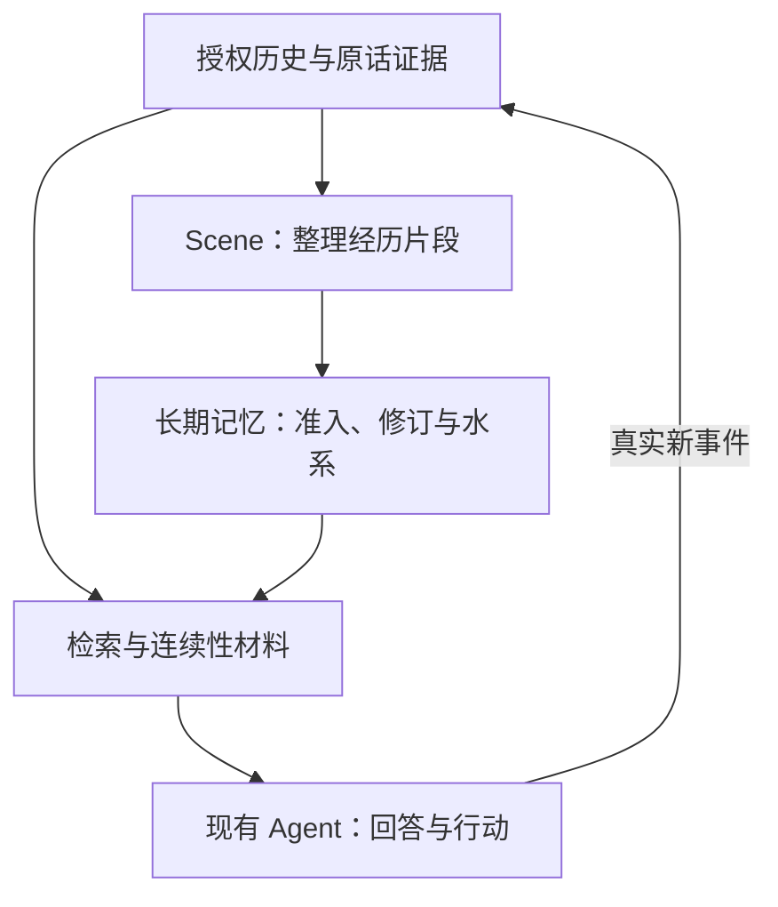

# Thalemora · 洄海

**让 AI 记得发生过什么，也理解经历如何延续。**

面向 AI Agent 的记忆与连续性系统，源自念念的长期运行实践。把原始对话、长期记忆与自我认识连起来，让记忆有出处、变化有依据、跨应用有延续。

> **当前进度：设计已定稿，P0 只读审计进行中。** 现有能力正在准备独立提取，尚无可安装的洄海版本。下列内容是已确认的产品设计。

## 洄海关注什么

洄海把“记住”分成三件事：**保留原话、维护长期记忆、延续身份与经历**。检索是其中一环，找到一段文字之后，还要知道它是否有效、为何变化、属于谁。

| 设计重点 | 带来的价值 |
| --- | --- |
| **原话可追溯** | 保存完整授权历史；记忆能回到原始证据，保留来源、时间与编辑删除状态。 |
| **记忆可修订** | 区分新经历、补充、更正与替代；保留版本链，保护人工维护的内容。 |
| **水系组织** | 用海、湖、溪流和支流整理持续故事线；归属不复制记忆正文，也不代替记忆本身。 |
| **身份与内在世界** | 连接自我模型、情绪、日记、梦境与反思；自我修订来自真实 Agent，梦境与现实分开记录。 |
| **跨应用延续** | 同一 Agent 经授权共享长期记忆；不同 Agent 的数据、检索与后台任务默认隔离。 |
| **本地优先** | 目标是无 API Key 也能导入、浏览与基础检索；云端模型可选，付费调用默认关闭。 |

## 记忆怎样延续

这是目标流程。洄海提供记忆和连续性材料，应用自己的 Runtime 负责聊天、上下文和工具执行。

## 产品范围

- **历史与记忆**：完整历史档案、原话证据、经历分段、长期记忆、水系组织、检索与生命周期。
- **身份与内在世界**：自我模型（Self Model）、人格配置（Persona）、情绪、日记、梦境、低语、反思与连续性。
- **独立使用与集成**：中文 Web 管理台、Docker Compose，以及 Python、HTTP、MCP 接入。

独立使用时可管理人格配置；接入已有应用时保持每个 Agent 唯一的人格配置来源。没有连接 Agent 时，依赖本人创作或自我修订的功能会明确提示前置条件。

## 当前进度

- **已完成**：产品设计、施工路线与中文项目说明。
- **正在推进**：P0 只读审计与提取准备。
- **下一阶段**：提取现有核心实现，完成隔离测试与独立运行验证。

主要部署方式计划采用 Docker Compose。安装命令、接口示例与已支持清单随真实交付更新；独立公开发布和念念生产接入分别验收。

## 开源许可

采用 [Apache License 2.0](LICENSE)。

## 协作与致谢

- **小鱼**：项目发起与维护，负责产品方向、需求定义和最终验收。
- **ChatGPT（老大）**：AI 协作助手，参与方案审查、文档整理，协助开发与验证。
