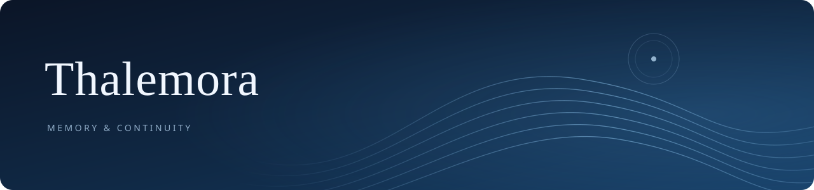

<div align="center">



洄海帮你把聊过的事情留下来。换个聊天窗口，也能找回以前的约定、后来的改口，以及你当时说的原话。记录保存在你自己的电脑或服务器上。

[第一次使用](docs/GETTING_STARTED.md) · [连接聊天软件](docs/PLUGIN_SETUP.md) · [下载 v0.10.0](https://github.com/Nereviay/Thalemora/releases/tag/v0.10.0)

</div>

## 改了主意，下次聊天也能接得上

比如，你先说「周六去看展」，过两天又说「周六有事，改周日吧」。

- **问「我们哪天去？」** 开启自动整理后，洄海可以把原来的约定更新为周日。以后聊天时用得上新安排，也能回头查到当初约的是周六。
- **问「我当时是怎么说的？」** 洄海会从你授权保存的聊天里找原句，区分你说的和对方说的。如果只想找当前这段对话，聊天软件还需要告诉洄海你在哪个窗口。
- **想翻一翻那天聊了什么？** 如果你用的应用接了每日摘要，摘要可以直接引用当时的话，并标出是谁说的。

v0.10.0 还可以导入从 ChatGPT 导出的文字聊天。如果你的聊天软件支持洄海的记忆工具，也可以请它「帮我记一笔」，或把误删的记忆从回收站找回来。[导入聊天与使用记忆工具](docs/MCP.md)

## 平时可以怎么用？

| 能力 | 对你意味着什么 |
| --- | --- |
| **留住原话** | 导入你选的聊天记录，以后可以搜原句、看是谁说的。 |
| **整理长期记忆** | 自己记一笔，或开启自动整理，让洄海从聊天里挑出值得留的事。 |
| **更新已有记忆** | 改了主意就能更新，旧版本仍可查。你亲自编辑的内容有保护。 |
| **串起持续的经历** | 用湖、溪流、支流整理故事线，未分类内容也能保存和查找。 |
| **在聊天前找回记忆** | 接好插件后，聊天软件会在回答前取回相关记忆。 |
| **自己掌握数据** | 在自己的电脑或服务器运行，为不同 AI 分开管理资料，支持导入、导出和备份。 |

洄海还提供自我认识、情绪、日记、梦境和反思等基础能力。涉及 AI 本人创作或修改自我认识的内容，需要聊天系统提供相应的真实行为记录。

## 怎么在聊天里用？

| 用法 | 连接后会发生什么 |
| --- | --- |
| **网页管理台** | 自己查看、搜索、整理记忆。 |
| **SillyTavern 插件** | 在扩展设置填写地址和专用召回凭据，发消息前自动找相关记忆。适配 1.19.0。 |
| **Operit 插件** | 导入插件后，在工具箱配置地址、专用凭据和开关；资料加入当轮请求，界面保留你的原话。适配 1.12.2。 |
| **MCP 工具** | 让支持 MCP 的聊天应用调用记忆工具；是否调用由应用和模型决定。 |
| **自己的应用** | 使用 Python 或 HTTP 接口，接入召回和历史同步。 |

**先运行洄海服务，再连接插件。** 手机聊天也可以连接电脑或服务器上的洄海，不必把服务装在手机上。

这两个插件会在你发消息时找旧记忆。要把新聊天也存下来，可以手动导入记录；自动保存需要聊天软件另外接入。

## 开始使用

1. 按设备安装：[Windows](docs/INSTALL_WINDOWS.md) · [Linux / 服务器](docs/INSTALL_LINUX.md) · [Android](docs/INSTALL_ANDROID.md)。
2. 打开管理台，注册一个 AI，授权历史来源；先用[练习记录](docs/examples/p4_history.json)体验搜索和人工记忆。
3. 想在聊天中使用记忆，再按[插件教程](docs/PLUGIN_SETUP.md)或 [MCP 教程](docs/MCP.md)连接。

**第一次试用，可以先不花模型调用费。** 导入练习记录、搜索原话、自己记一笔，都可以直接用。想让模型自动整理，再连接你选的服务商，费用按对方的规则计算。

整理在后台运行，聊天前只请求召回，不等待后台整理模型。

<details>
<summary><strong>熟悉命令行？展开 Linux 快速安装</strong></summary>

需要 Python 3.10 或更新版本。

```bash
git clone --depth 1 --branch v0.10.0 https://github.com/Nereviay/Thalemora.git
cd Thalemora
python3 -m venv .venv
./.venv/bin/python -m pip install -c requirements.lock .
export THALEMORA_TOKEN="$(./.venv/bin/python -c 'import secrets; print(secrets.token_urlsafe(32))')"
printf '%s\n' "$THALEMORA_TOKEN"
./.venv/bin/thalemora --data ./state serve
```

打开 `http://127.0.0.1:8765`，用终端显示的管理密钥登录并保存好它。下次启动沿用原密钥与数据目录。Windows 和 Docker 见对应安装教程。

</details>

## 使用前了解

- 洄海提供记忆服务，聊天仍在原来的应用中进行。
- Android 本机运行需要手动准备 Linux 工作区，目前没有独立 APK 或一键安装器。
- 酒馆插件的召回凭据保存在当前标签页：刷新保留，关页后需重填；Operit 使用本机 App 配置。
- 本地检索不自动下载模型；向量检索和重排可分别关闭、使用本地模型或连接 API。
- 远程访问需配置可信网络或 HTTPS；备份应先停止所有写入。

## 更多资料

| 想做什么 | 文档 |
| --- | --- |
| 第一次使用、选择运行设备 | [新手指南](docs/GETTING_STARTED.md) |
| 配置聊天插件 | [SillyTavern / Operit](docs/PLUGIN_SETUP.md) |
| 连接 MCP | [MCP 配置](docs/MCP.md) |
| 开启自动整理、配置检索模型 | [模型与后台整理](docs/AUTOMATIC_MEMORY.md) |
| 自己开发接入 | [接口手册](docs/USAGE.md) · [聊天前召回](docs/RECALL_API.md) |
| 升级、备份和恢复 | [维护说明](docs/MAINTENANCE.md) |
| 查看本版变化 | [更新记录](docs/CHANGELOG.md) |

## 开源与致谢

洄海采用 [Apache License 2.0](LICENSE)。

记忆设计参考了 [Yinglianchun/Ombre-Brain](https://github.com/Yinglianchun/Ombre-Brain) 及其上游 [Ombre Brain](https://github.com/P0luz/Ombre-Brain)，也参考了 [Serein](https://github.com/Yinglianchun/Serein)、[Haven-Ombre](https://github.com/Yinglianchun/Haven-Ombre)、[Paramecium](https://github.com/Shitsuten/paramecium) 和 [awesome-ai-companion](https://github.com/DasterProkio/awesome-ai-companion)。继承的设计、原作者版权与第三方许可见[第三方声明](THIRD_PARTY_NOTICES.md)。

**项目发起与维护：** 小鱼（产品方向、需求与验收）<br>
**AI 协作：** ChatGPT（Kiko）（方案、开发协助、审查与文档）
