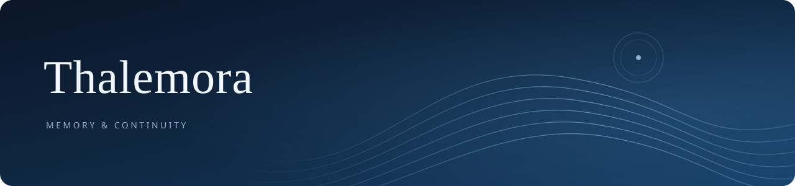

<div align="center">



**让 AI 记得过去，也让每一段记忆有迹可循。**

洄海（Thalemora）是一套**独立、开源、可自行部署的 AI 长期记忆系统**。<br>
保存聊天原话，整理值得记住的事情，让已连接的聊天应用在需要时找回相关经历。

[开始使用](docs/GETTING_STARTED.md) · [安装插件](docs/PLUGIN_SETUP.md) · [下载 v0.8.1](https://github.com/Nereviay/Thalemora/releases/tag/v0.8.1) · [使用文档](docs/README.md)

</div>

## 为什么做洄海？

换了聊天窗口，不想再把宠物、项目、偏好和重要约定从头解释一遍。

> 你告诉 AI：“我家的猫叫豆包，它喜欢趴在窗台晒太阳。”<br>
> 后来又说：“豆包最近不睡窗台了，天天钻我被窝。”
>
> 洄海可以保存两次对话的原话；开启自动整理后，把相关内容作为同一段经历的变化来处理。以后查到记忆，也能回头看当时究竟说了什么。

**记忆不只是孤立的卡片，也应当能补充、更正和延续。**

## 它能做什么？

| 能力 | 对你意味着什么 |
| --- | --- |
| **留住原话** | 保存你授权导入的历史，记忆可以回查来源。 |
| **整理长期记忆** | 手动保存，或配置模型后在后台提炼事实、偏好、约定和经历。 |
| **更新已有记忆** | 补充、更正或替代旧内容，保留修改记录；保护你亲自编辑的记忆。 |
| **串起持续的经历** | 用湖、溪流、支流整理故事线，未分类内容也能保存和查找。 |
| **在聊天前找回记忆** | 为 SillyTavern 和 Operit 提供插件适配，在发送前把相关记忆加入本轮请求。 |
| **自己掌握数据** | 在自己的电脑或服务器运行，为不同 AI 分开管理资料，支持导入、导出和备份。 |

洄海还提供自我认识、情绪、日记、梦境和反思等基础能力。涉及 AI 本人创作或修改自我认识的内容，需要聊天系统提供相应的真实行为记录。

## 怎样连接聊天软件？

| 用法 | 连接后会发生什么 |
| --- | --- |
| **网页管理台** | 自己查看、搜索、整理记忆。 |
| **SillyTavern 插件** | 在扩展设置填写地址和专用召回凭据，发消息前自动找相关记忆。适配 1.19.0。 |
| **Operit 插件** | 导入插件后，在工具箱配置地址、专用凭据和开关；资料加入当轮请求，界面保留你的原话。适配 1.12.2。 |
| **MCP 工具** | 让支持 MCP 的聊天应用调用记忆工具；是否调用由应用和模型决定。 |
| **自己的应用** | 使用 Python 或 HTTP 接口，接入召回和历史同步。 |

**先运行洄海服务，再连接插件。** 手机聊天也可以连接电脑或服务器上的洄海，不必把服务装在手机上。

自动召回和保存新聊天是两件事：这两个插件负责找回已有记忆，**不会自动把新聊天同步回洄海**。其他客户端按其插件或接口能力接入，不能通装同一个插件包。

## 开始使用

1. 按设备安装：[Windows](docs/INSTALL_WINDOWS.md) · [Linux / 服务器](docs/INSTALL_LINUX.md) · [Android](docs/INSTALL_ANDROID.md)。
2. 打开管理台，注册一个 AI，授权历史来源；先用[练习记录](docs/examples/p4_history.json)体验搜索和人工记忆。
3. 想在聊天中使用记忆，再按[插件教程](docs/PLUGIN_SETUP.md)或 [MCP 教程](docs/MCP.md)连接。

**不用先购买模型 API。** 浏览、导入、基础检索和人工管理无需模型 Key。后台自动整理、向量检索和重排按用途配置；使用第三方 API 可能产生对应服务商的费用。

整理在后台运行，聊天前只请求召回，不等待后台整理模型。

<details>
<summary><strong>熟悉命令行？展开 Linux 快速安装</strong></summary>

需要 Python 3.10 或更新版本。

```bash
git clone --depth 1 --branch v0.8.1 https://github.com/Nereviay/Thalemora.git
cd Thalemora
python3 -m venv .venv
./.venv/bin/python -m pip install -c requirements.lock .
export THALEMORA_TOKEN="$(./.venv/bin/python -c 'import secrets; print(secrets.token_urlsafe(32))')"
printf '%s\n' "$THALEMORA_TOKEN"
./.venv/bin/thalemora --data ./state serve
```

打开 `http://127.0.0.1:8765`，用终端显示的管理密钥登录并保存好它。下次启动沿用原密钥与数据目录。Windows 和 Docker 见对应安装教程。

</details>

## 使用前了解

- 洄海提供记忆服务，聊天仍在原来的应用中进行。
- Android 本机运行需要手动准备 Linux 工作区，目前没有独立 APK 或一键安装器。
- 酒馆插件的召回凭据保存在当前标签页：刷新保留，关页后需重填；Operit 使用本机 App 配置。
- 本地检索不自动下载模型；向量检索和重排可分别关闭、使用本地模型或连接 API。
- 远程访问需配置可信网络或 HTTPS；备份应先停止所有写入。

## 更多资料

| 想做什么 | 文档 |
| --- | --- |
| 第一次使用、选择运行设备 | [新手指南](docs/GETTING_STARTED.md) |
| 配置聊天插件 | [SillyTavern / Operit](docs/PLUGIN_SETUP.md) |
| 连接 MCP | [MCP 配置](docs/MCP.md) |
| 开启自动整理、配置检索模型 | [模型与后台整理](docs/AUTOMATIC_MEMORY.md) |
| 自己开发接入 | [接口手册](docs/USAGE.md) · [聊天前召回](docs/RECALL_API.md) |
| 升级、备份和恢复 | [维护说明](docs/MAINTENANCE.md) |
| 查看本版变化 | [更新记录](docs/CHANGELOG.md) |

## 开源与致谢

洄海采用 [Apache License 2.0](LICENSE)。

记忆设计参考了 [Yinglianchun/Ombre-Brain](https://github.com/Yinglianchun/Ombre-Brain) 及其上游 [Ombre Brain](https://github.com/P0luz/Ombre-Brain)，也参考了 [Serein](https://github.com/Yinglianchun/Serein)、[Haven-Ombre](https://github.com/Yinglianchun/Haven-Ombre)、[Paramecium](https://github.com/Shitsuten/paramecium) 和 [awesome-ai-companion](https://github.com/DasterProkio/awesome-ai-companion)。继承的设计、原作者版权与第三方许可见[第三方声明](THIRD_PARTY_NOTICES.md)。

**项目发起与维护：** 小鱼（产品方向、需求与验收）<br>
**AI 协作：** ChatGPT（老大）（方案、开发协助、审查与文档）