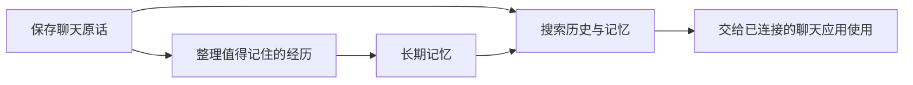

<div align="center">


**让 AI 记得过去，也让每一段记忆有迹可循。**

洄海（Thalemora）是一套**独立、开源、可自行部署的 AI 长期记忆系统**。  
它帮你保存聊天原话、整理值得记住的事情，并在需要时找回相关经历。

[第一次使用](docs/GETTING_STARTED.md) · [它能做什么](#它能做什么) · [怎样连接聊天软件](#怎样让-ai-在聊天中用上记忆) · [下载 v0.6.0](https://github.com/yuyu1838309000-cmd/Thalemora/releases/tag/v0.6.0)

</div>

---

## 为什么做洄海？

你可能和 AI 聊过很多事情：养的宠物、正在做的项目、一次重要的决定，或一段不想反复解释的经历。

换了聊天窗口之后，这些事情不应该只能靠你一遍遍重讲。

**洄海想做的，是让记忆不止是一张张孤立的卡片，而是一段可以继续发展的经历。**

举个例子：

> 你告诉 AI：“我家的猫叫豆包，它特别喜欢趴在窗台晒太阳。”  
>  
> 后来你又说：“豆包最近不睡窗台了，天天钻我被窝。”  
>  
> 洄海可以保存两次对话的原话；开启自动整理后，还可以判断这是不是同一件事的后续变化，而不是简单地堆两条互不相关的记录。
>
> 以后想起豆包时，可以查到相关记忆，也能回头看当时究竟说了什么。

**要让 AI 在每轮聊天前自动拿到这些记忆，还需要聊天软件接入召回流程。** 洄海目前提供搜索和连接接口，但独立版尚未提供适用于所有聊天软件的即装即用自动注入。

## 它能做什么？

| 能力 | 对你意味着什么 |
| --- | --- |
| **留住原话** | 保存经你授权的聊天历史；想确认某件事时，可以找到当时的说法。 |
| **整理长期记忆** | 把重要的事实、偏好、约定和经历保存下来，而不是每句话都变成永久记忆。 |
| **让记忆可以更新** | 新变化可以补充、纠正或替代旧内容；保留修改记录，不随意覆盖你亲自写下的记忆。 |
| **把经历串起来** | 用“海、湖、溪流、支流”组织持续的故事线；暂未分类的记忆也能保存和查找。 |
| **为不同 AI 分开保管** | 可以为多个 AI 建立各自的记忆空间；经过授权，同一个 AI 也可以连接不同应用的历史。 |
| **自己掌握数据** | 可以在自己的电脑或服务器运行，导入、导出和备份；无需把私人聊天放进公开仓库。 |

洄海还提供 AI 的自我认识、情绪状态、日记、梦境和反思等基础管理能力。涉及 AI 本人创作或修改自我认识的内容，需要连接能够提供真实行为记录的聊天系统，不会由后台程序冒充 AI 完成。

## 记忆是怎样工作的？



- **保存：** 导入已有聊天记录，或由支持的聊天应用持续同步新消息。
- **整理：** 你可以手动保存记忆；也可以自行配置模型，让后台定期提炼值得长期保留的内容。
- **查找：** 通过管理台、接口或聊天工具，检索记忆和历史原话，查看它们的来源。

自动整理默认关闭，不配置模型也能浏览、搜索和人工管理记忆。启用模型后可能产生你所选服务商的费用，可以设置调用预算。

## 怎样让 AI 在聊天中用上记忆？

这是最重要的使用区别：

| 连接方式 | 目前能做到什么 |
| --- | --- |
| **打开洄海管理台** | 自己查看、查找、整理记忆，不依赖聊天软件。 |
| **连接 MCP 记忆工具** | AI 可以调用工具查历史和记忆，但是否调用由聊天软件和模型决定。 |
| **聊天应用主动接入洄海接口** | 应用可以在生成回复前先取回相关记忆，再放进该轮聊天的上下文。需要应用端进行对接。 |

**当前 v0.6.0 尚未提供适用于普通聊天软件的通用自动召回插件。** 仅填写 MCP 地址，不意味着每轮聊天都会自动回忆；聊天记录也不会凭空自动同步。

我们希望最终实现的是：**正常发消息，相关记忆在需要时自然出现，不需要用户反复提醒 AI 去查。** 这是后续接入体验的重点，不能把目标写成现有功能。

## 现在可以开始体验吗？

**可以。** 公开版 **v0.6.0** 已支持：

- 中文网页管理台，浏览、导入、搜索聊天原话与记忆。
- 手动保存和修改记忆，查看依据与历史版本，整理水系。
- 为不同 AI 分开管理资料，并授权聊天来源。
- 配置模型后启动后台自动整理；不配置也能使用基础功能。
- 通过 Python、HTTP 或 MCP 与其他软件连接，以及导出、备份和恢复数据。

**目前的使用门槛：** 需要自行安装 Python 环境或使用 Docker。Windows 的 Python 安装、Linux 的 Docker 安装已有实测；只有 Android 手机的完整独立安装和长期后台运行仍待验证，暂时没有一键安装包。

### 新手从这里开始

1. 阅读 [第一次使用洄海](docs/GETTING_STARTED.md)，按设备选择教程：[Windows](docs/INSTALL_WINDOWS.md) / [Linux 与服务器](docs/INSTALL_LINUX.md) / [Android 试装与限制](docs/INSTALL_ANDROID.md)。
2. 启动洄海，在浏览器打开本机管理台，注册一个 AI 并授权数据来源。
3. 先导入[练习聊天记录](docs/examples/p4_history.json)，试着搜索一句原话、保存一条记忆、查看来源。**不需要先购买模型 API。**

<details>
<summary><strong>熟悉命令行？展开快速安装</strong></summary>

需要 Python 3.10 或更新版本。以下是 Linux/macOS 终端示例；Windows 请按上方单独教程操作。

```bash
git clone --depth 1 --branch v0.6.0 https://github.com/yuyu1838309000-cmd/Thalemora.git
cd Thalemora
python3 -m venv .venv
. .venv/bin/activate
python -m pip install -c requirements.lock .
export THALEMORA_TOKEN="$(python -c 'import secrets; print(secrets.token_urlsafe(32))')"
printf '%s\n' "$THALEMORA_TOKEN"
thalemora --data ./state serve
```

打开 `http://127.0.0.1:8765`，使用终端显示的管理密钥登录。该密钥能管理整个实例，**不要分享给他人**。启动时不会自动下载模型或产生模型调用费用。

Docker 安装、后台整理设置和备份方法见下方使用文档。

</details>

## 更多资料

| 想了解什么 | 去哪里看 |
| --- | --- |
| 第一次使用与界面操作 | [新手指南](docs/GETTING_STARTED.md) |
| 后台自动整理记忆 | [自动记忆使用说明](docs/PRE6_4B_USAGE.md) |
| 接口、MCP 和程序接入 | [完整使用手册](docs/P4_USAGE.md) |
| 已知安装难点 | [安装限制与改进清单](docs/INSTALL_FRICTION.md) |
| 更新、备份与恢复 | [维护与恢复说明](docs/MAINTENANCE.md) |
| 公开版本 | [GitHub Releases](https://github.com/yuyu1838309000-cmd/Thalemora/releases) |

## 开源与致谢

洄海采用 [Apache License 2.0](LICENSE) 开源。

记忆设计参考了 [Yinglianchun/Ombre-Brain](https://github.com/Yinglianchun/Ombre-Brain) 及其上游 [Ombre Brain](https://github.com/P0luz/Ombre-Brain)，也参考了 [Serein](https://github.com/Yinglianchun/Serein)、[Haven-Ombre](https://github.com/Yinglianchun/Haven-Ombre)、[Paramecium](https://github.com/Shitsuten/paramecium) 等项目。继承的设计、原作者版权和第三方许可证均在 [第三方声明](THIRD_PARTY_NOTICES.md) 中说明。

**项目发起与维护：** 小鱼（产品方向、需求与验收）  
**AI 协作：** ChatGPT（老大）（方案、开发协助、审查与文档）

---

<div align="center">

**让过去的对话，成为未来仍然有用的记忆。**

</div>
