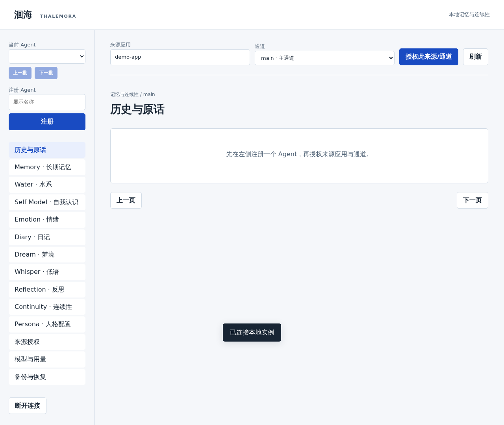
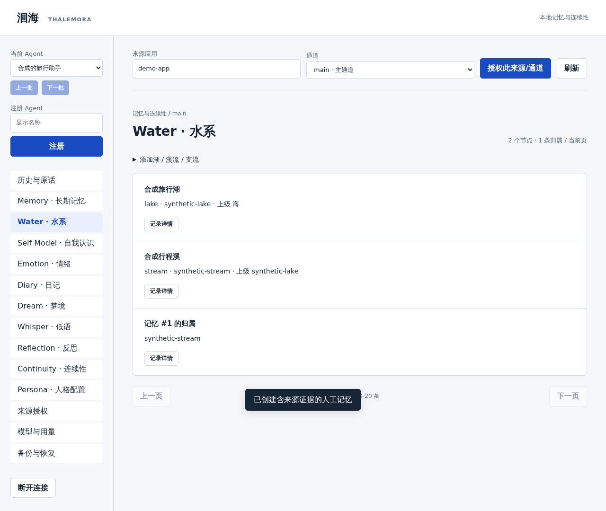
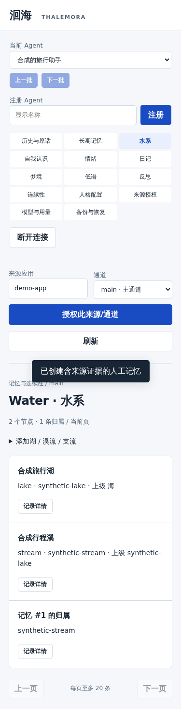
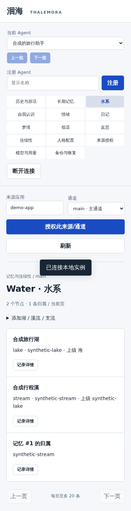

# 第一次使用洄海：从安装到看到第一条记忆

> 适合第一次接触这类工具的用户。先看你手上有什么设备，再按对应教程操作。不需要购买模型 API，也不需要把真实聊天导入做测试。

**版本提醒**：公开版为 v0.6.0，含 HTTP MCP 九工具与可配置的独立后台记忆 worker。首次浏览、导入与人工管理无需模型 Key；自动整理需另行配置并启动 worker。**P8 的每轮聊天前自动召回与专用连接凭据尚未公开，真实手机客户端 Hook 未验收。** 尚无独立 Android 安装包或一键安装，手机独立首装尚未验收。

**不确定自己该选手机工作区、Windows、VPS，或不知道 MCP 与插件区别？** 先看 [按设备、目的和客户端能力选路线](CHOOSE_YOUR_SETUP.md)。

## 1. 我应该选哪条路线？

| 你有什么 | 从哪里开始 | 目前的实际情况 |
| --- | --- | --- |
| Windows 电脑 | [Windows 教程](INSTALL_WINDOWS.md) | Python 路线已在一台 Windows 电脑隔离首装与浏览器操作验证；Windows Docker Desktop 未测 |
| Linux 电脑或自己的 Linux 服务器 | [Linux 教程](INSTALL_LINUX.md) | Python/Compose 路线在独立 Linux 环境验收过；陌生机器仍需自己安装依赖 |
| 只有 Android 手机，并使用 RikkaHub | [手机教程](INSTALL_ANDROID.md) | Android 17 真机曾在测试候选上完成工作区试装、九工具连接；公开 v0.6.0 **具备 HTTP MCP**，但仍未完成独立手机零基础首装或真实聊天自动注入验收 |
| iPhone / iPad | 暂无可验证的本机安装方法 | 没有通过的 iOS 本地运行方案；不要照抄 Android 命令 |

**一句话理解**：洄海是一套运行中的“记忆服务”，不是聊天软件。管理台让你自己管理记忆；要让其他聊天应用使用记忆，还需把两者连接。只保存文件到网盘不等于启动了服务。

## 2. 安装后先做这四件事

打开本机浏览器 `http://127.0.0.1:8765`。这里的地址只代表**当前这台运行洄海的设备**；它不是互联网上的公共网址。

1. **填管理密钥**：启动时设置的 `THALEMORA_TOKEN` 就是管理密钥。它能管理整个实例，不要把它发给别人、放到截图或分享到群里。
2. **注册 Agent**：填一个容易辨认的名字，例如“旅行助手”。Agent 可以理解成“记忆归属于谁”。
3. **授权来源**：先用 `demo-app`、通道 `main`。这代表“允许这个助手管理来自 demo-app 普通对话的历史”。私人通道 `private` 不会自动授权。
4. **导入练习数据**：在「历史与原话」里选 [两条纯合成示例](examples/p4_history.json)，搜索「旅行计划」，找到后点「原文存为人工记忆」，再进 Memory 查看「来源证据」。

以上操作不用配置模型、也不会自动从 ChatGPT/RikkaHub 抓取对话。导入历史是保存证据；**不是自动提炼成长期记忆**。

## 3. 照着截图找页面

这些是 **PRE6-1 真实浏览器合成测试截图**，内容全部是虚构练习数据，不是手机原生 App 截屏，不同软件版本与屏幕宽度下按钮位置可能变化。

**第 1 张：空实例登录后**。先注册一个 Agent、授权来源，再进入历史页面。

**第 2 张：水系管理**。创建一座湖、一条溪流，把练习记忆放入溪流。

**第 3 张：窄屏管理台**。浏览器窗口缩窄后的实际显示；这不是 Android 端安装界面。

**第 4 张：重启后仍能看到数据**。关闭并重新启动测试服务，再登录同一数据目录，来源和水系仍在。

## 4. 常见情况怎么判断

| 你看到的情况 | 先做什么 |
| --- | --- |
| 浏览器打不开 `127.0.0.1:8765` | 确认运行洄海的终端/容器还开着；如果在另一台设备的浏览器输入 localhost，访问的是另一台设备 |
| 提示认证失败 / 401 | 检查管理密钥是否和本次启动使用的一致；别把 `Bearer ` 前缀粘进 Web 管理密钥框 |
| 注册成功，却不能导入 | 检查是否先授权了相同的来源 `app` 和 `channel`，示例使用 `demo-app/main` |
| 只有历史，看不到自动记忆 | 仅导入不会自动提炼；v0.6.0 的独立 worker 需另外配置相应用途模型、启动处理，并有可信历史来源。也可以先用「原文存为人工记忆」 |
| RikkaHub MCP 连不上 | 先确认服务器已运行、版本含 HTTP MCP、地址是手机本机、请求头格式正确；详见 [手机排查](INSTALL_ANDROID.md#手机上的-mcp-连接步骤v050-候选已实测) |
| 找不到「自动整理」按钮 | v0.6.0 的自动整理通过显式 worker 运行，不代表 Web 界面一定提供一键自动整理按钮；参见 [后台记忆说明](PRE6_4B_USAGE.md) |

## 5. 使用前记住三件事

- **当前使用入口和数据根要一致**。重新打开同一 `state` 才能继续使用原数据；不要为了“更新”覆盖旧目录。
- **整机备份前先停止所有写入**，再依照 [完整备份与恢复说明](P4_USAGE.md#全量历史导出与恢复) 操作；不要随便复制一个正在写入的 SQLite 文件就当一致备份。换设备时恢复到新空目录。
- **网盘只负责放备份文件**，不会替你运行 Python、数据库或 MCP；目前没有自动对接百度/夸克/Drive 的功能。

想知道为什么安装还需要这么多操作、下一步准备简化什么：看 [安装难点与优化清单](INSTALL_FRICTION.md)。开发者参数、版本证据和 API 见 [完整使用手册](P4_USAGE.md)。
